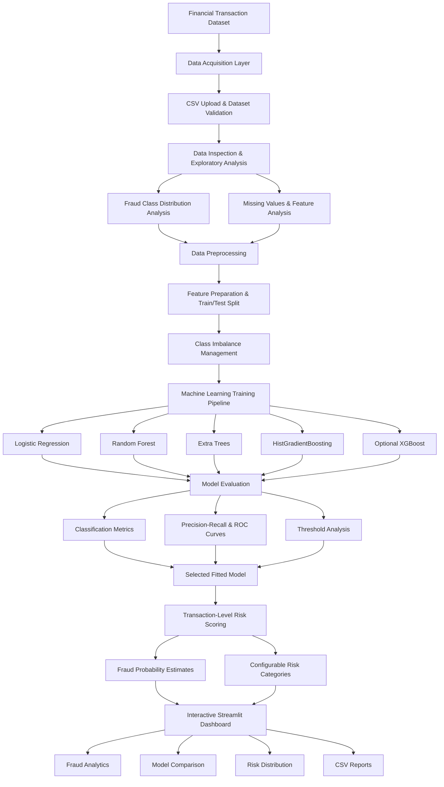
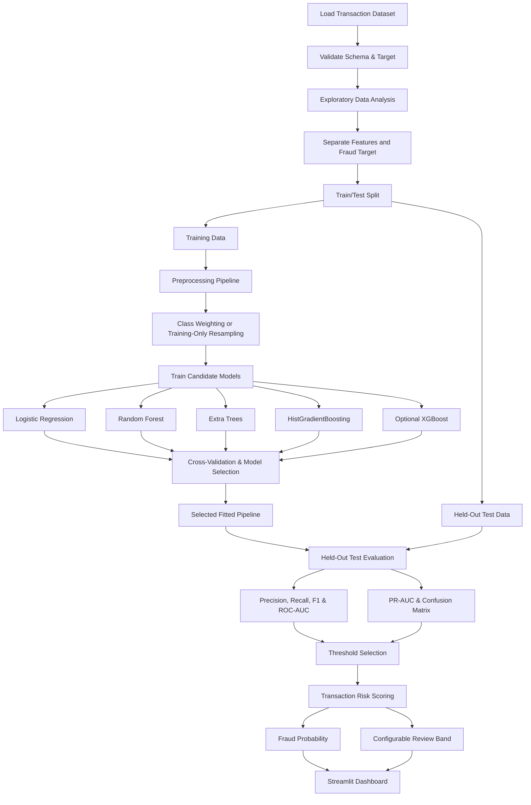

# Intelligent Financial Fraud Detection and Risk Analytics

## AI-Powered Transaction Fraud Detection and Financial Risk Intelligence

An end-to-end **Financial Fraud Detection and Risk Analytics System** that combines machine learning, transaction analysis, class-imbalance handling, and risk scoring to identify potentially suspicious financial transactions. The platform demonstrates a complete fraud analytics workflow, including transaction-data ingestion, exploratory analysis, leakage-aware preprocessing, classification model training, performance evaluation, decision-threshold analysis, and transaction-level risk scoring.

It supports Logistic Regression, Random Forest, Extra Trees, HistGradientBoosting, and optional XGBoost models, with an interactive Streamlit dashboard for exploring fraud patterns, comparing model performance, and analysing transaction risk.

> **Project Status:** This is an educational and research-oriented prototype, not a production fraud-prevention service. It does not include a pretrained fraud model or verified performance results. Models must be trained and evaluated using an authorised dataset before reporting experimental findings.

---

## Project Objectives

- Analyse financial transaction datasets and identify fraud-related patterns.
- Explore class imbalance and its impact on classification performance.
- Develop reusable and leakage-aware machine-learning pipelines.
- Compare baseline and ensemble classification algorithms.
- Apply appropriate techniques to address imbalanced training data.
- Evaluate models using precision, recall, F1-score, ROC-AUC, and PR-AUC.
- Analyse classification thresholds and false-positive/false-negative trade-offs.
- Generate transaction-level fraud probability estimates and configurable risk bands.
- Develop an interactive financial fraud analytics dashboard.
- Export model evaluation results and scored transaction records.

## Key Features

- **Transaction Data Upload:** Supports CSV-based financial transaction datasets.
- **Dataset Profiling:** Examines transaction columns, data types, missing values, and statistical summaries.
- **Fraud Class Distribution:** Analyses legitimate and fraudulent transaction proportions.
- **Data Preprocessing:** Handles missing values, feature preparation, and consistent transformations.
- **Class-Imbalance Handling:** Supports class weighting and optional training-only resampling.
- **Multiple ML Algorithms:** Compares Logistic Regression, Random Forest, Extra Trees, and HistGradientBoosting.
- **Optional XGBoost:** Supports gradient-boosted classification when the dependency is installed.
- **Stratified Model Evaluation:** Preserves class proportions during suitable train/test splitting.
- **Comprehensive Metrics:** Calculates precision, recall, F1-score, ROC-AUC, average precision, and confusion matrix.
- **Precision-Recall Analysis:** Evaluates fraud detection under severe class imbalance.
- **Threshold Optimisation:** Examines the trade-off between detecting fraud and generating false alarms.
- **Transaction Risk Scoring:** Generates model-estimated fraud probabilities and configurable review categories.
- **Interactive Dashboard:** Presents transaction analytics, model comparisons, and risk distributions.
- **CSV Export:** Downloads evaluation summaries and scored transaction records.

---

## System Architecture

The platform follows a modular machine-learning architecture that transforms raw financial transaction data into evaluated classification models and transaction-level risk indicators.

The system is organised into eight major layers:

1. Transaction Data Acquisition
2. Dataset Inspection and Exploratory Analysis
3. Data Preprocessing and Feature Preparation
4. Class-Imbalance Management
5. Machine Learning Model Training
6. Model Evaluation and Threshold Analysis
7. Transaction Risk Scoring
8. Dashboard Visualisation and Report Generation

### 1. Overall System Architecture



### 2. Architecture Components

| Architecture Layer | Components | Responsibility |
|---|---|---|
| Data Acquisition | CSV upload, dataset loader | Imports authorised financial transaction records. |
| Data Validation | Schema checks, data-quality checks | Validates input columns, target labels, and data consistency. |
| Exploratory Analysis | Statistical summaries, class distribution | Examines transaction characteristics and fraud imbalance. |
| Preprocessing | Imputation, scaling, feature preparation | Prepares transaction features for model training. |
| Data Splitting | Stratified or temporal splitting | Separates training and evaluation observations. |
| Imbalance Management | Class weighting, optional resampling | Addresses minority-class representation during training. |
| Model Training | Classification algorithms | Trains and compares fraud classification models. |
| Model Evaluation | Classification metrics and curves | Measures predictive performance. |
| Threshold Analysis | Precision-recall trade-offs | Examines different fraud decision thresholds. |
| Risk Scoring | Probability estimation and risk bands | Produces model-based transaction risk indicators. |
| Presentation | Streamlit dashboard and CSV export | Communicates fraud analytics and model results. |

### 3. Detailed Data Processing Architecture

**Stage 1 — Transaction Data Acquisition**

The system accepts structured financial transaction datasets through CSV upload or configured local data sources.

The commonly used Credit Card Fraud Detection dataset contains:

- Anonymised PCA-derived features.
- `Time` — elapsed time information in the original dataset.
- `Amount` — transaction amount.
- `Class` — target variable.

For this dataset:

- `Class = 0` represents a legitimate transaction.
- `Class = 1` represents a fraudulent transaction.

Other authorised transaction datasets can be used if their target definitions and feature meanings are documented.

**Stage 2 — Data Validation and Exploratory Analysis**

Uploaded data is inspected before model training.

Operations include:

- Dataset dimensions and column inspection.
- Data-type validation.
- Missing-value analysis.
- Duplicate record checks.
- Target-variable validation.
- Fraud and legitimate transaction counts.
- Class imbalance calculation.
- Transaction amount distribution analysis.
- Numerical feature correlation analysis.

The fraud proportion can be calculated as:

\[
Fraud\ Rate=
\frac{N_{fraud}}{N_{total}}\times100
\]

Where:

- \(N_{fraud}\) = Number of fraudulent transaction records.
- \(N_{total}\) = Total transaction records.

**Stage 3 — Data Preprocessing**

The preprocessing pipeline prepares transaction records for machine-learning algorithms.

| Operation | Purpose |
|---|---|
| Missing-Value Handling | Handles incomplete transaction features. |
| Duplicate Checks | Identifies repeated records for investigation. |
| Feature Preparation | Selects valid model input variables. |
| Numerical Scaling | Standardises numerical features where required. |
| Target Separation | Separates fraud labels from input features. |
| Input Validation | Checks new transaction records against the trained model schema. |

Preprocessing transformations must be fitted only on training data. A scikit-learn Pipeline or ColumnTransformer helps ensure consistent transformations and reduces data leakage.

**Stage 4 — Train/Test Splitting**

The dataset is separated into training and testing subsets.

For suitable independent observations, stratified splitting preserves the relative proportion of fraud and legitimate transactions.

For transaction data with a meaningful time dimension, chronological splitting is generally preferable because it evaluates whether a model trained on earlier transactions generalises to later transactions.

The final test set must not be repeatedly used for model selection or threshold tuning.

**Stage 5 — Class-Imbalance Management**

Financial fraud datasets often contain significantly fewer fraudulent transactions than legitimate transactions.

The system supports two primary strategies:

- **Class Weighting:** Assigns greater training importance to the minority fraud class.
- **Training-Only Resampling:** Uses optional imbalanced-learn techniques to adjust class distribution within the training data.

Resampling must occur only within the training data or inside each cross-validation training fold. Never resample the full dataset before splitting, as this can introduce data leakage and produce misleading evaluation results.

**Stage 6 — Machine Learning Model Training**

The platform supports multiple classification algorithms.

| Algorithm | Role |
|---|---|
| Logistic Regression | Baseline classification model. |
| Random Forest | Ensemble classification using multiple decision trees. |
| Extra Trees | Randomised tree-based ensemble learning. |
| HistGradientBoosting | Gradient-boosted decision-tree classification. |
| XGBoost | Optional advanced gradient-boosted classification. |

Each model is trained using the prepared training data and evaluated using a consistent evaluation strategy.

**Stage 7 — Model Evaluation**

The trained models are evaluated using metrics appropriate for highly imbalanced classification.

Core metrics include:

- Precision
- Recall
- F1-score
- ROC-AUC
- Average Precision / PR-AUC
- Confusion matrix

Precision-recall analysis is particularly important because a fraud detection model must identify fraudulent transactions while limiting unnecessary flags on legitimate customers.

**Stage 8 — Threshold Analysis**

The model's fraud probability estimates are converted into class predictions using a configurable threshold.

For a threshold \(t\):

\[
\hat{y}=
\begin{cases}
1 & \text{if } P(y=1\mid X)\geq t\\
0 & \text{otherwise}
\end{cases}
\]

Where:

- \(P(y=1\mid X)\) = Model-estimated fraud probability.
- \(t\) = Selected decision threshold.
- \(\hat{y}\) = Predicted transaction class.

Changing the threshold affects:

- Fraud detection recall.
- Fraud prediction precision.
- False-positive volume.
- False-negative volume.

The appropriate threshold depends on operational capacity, customer impact, and the relative costs of missed fraud and unnecessary reviews.

**Stage 9 — Transaction-Level Risk Scoring**

The selected fitted model processes transaction records and generates model-estimated fraud probabilities.

These scores can be mapped into configurable review categories.

Example conceptual categories:

| Risk Category | Interpretation |
|---|---|
| Low | Lower model-estimated fraud probability. |
| Moderate | Intermediate model-estimated fraud probability. |
| High | Higher model-estimated fraud probability. |

Risk bands must be configured and validated for the selected dataset and use case. They are not universal financial risk standards.

**Stage 10 — Dashboard and Reporting**

The Streamlit dashboard brings together transaction analytics and model evaluation.

Possible dashboard sections include:

- Dataset overview.
- Fraud and legitimate transaction distribution.
- Transaction feature analysis.
- Model comparison.
- Confusion matrix.
- ROC curve.
- Precision-recall curve.
- Threshold analysis.
- Transaction-level risk scores.
- Risk category distribution.
- Downloadable CSV reports.

### 4. Detailed Model Training and Risk Scoring Workflow



---

## Suggested Dataset

### Primary Dataset

**Credit Card Fraud Detection Dataset**

Source: [Kaggle – Credit Card Fraud Detection](https://www.kaggle.com/datasets/mlg-ulb/creditcardfraud)

The commonly used European card transaction dataset contains anonymised PCA-derived features, transaction time, transaction amount, and a binary fraud target.

| Column | Description |
|---|---|
| `Time` | Elapsed time information in the dataset. |
| `V1`–`V28` | Anonymised PCA-derived transaction features. |
| `Amount` | Transaction amount. |
| `Class` | Fraud target: 0 = legitimate, 1 = fraudulent. |

### Dataset Preparation

Suggested local directory:

```text
data/
└── raw/
    └── creditcard.csv
```

Alternative datasets may be used if they provide:

- Clearly defined fraud labels.
- Documented transaction features.
- Appropriate usage permissions.
- Sufficient observations for meaningful evaluation.
- Reliable provenance and target definitions.

**Data protection:** Do not commit real cardholder information, payment credentials, account numbers, names, addresses, or other sensitive transaction records to GitHub.

---

## Technology Stack

| Category | Technologies |
|---|---|
| Programming Language | Python |
| Data Processing | Pandas, NumPy |
| Machine Learning | Scikit-learn |
| Classification Models | Logistic Regression, Random Forest, Extra Trees, HistGradientBoosting |
| Optional Boosting | XGBoost |
| Imbalanced Learning | imbalanced-learn |
| Data Visualisation | Matplotlib, Seaborn, Plotly |
| Dashboard | Streamlit |
| Model Evaluation | Scikit-learn Metrics |
| Model Persistence | Joblib |
| Testing | Pytest |
| Dataset Format | CSV |
| Development Environment | Jupyter Notebook, VS Code |
| Version Control | Git, GitHub |

---

## Repository Structure

```text
Intelligent-Financial-Fraud-Detection/
│
├── dashboard/
│   └── app.py
│
├── src/
│   ├── preprocessing.py
│   ├── models.py
│   ├── evaluation.py
│   ├── risk_scoring.py
│   └── train.py
│
├── data/
│   ├── raw/
│   │   └── README.md
│   └── processed/
│       └── README.md
│
├── models/
│   └── README.md
│
├── reports/
│   └── figures/
│
├── docs/
│   ├── architecture.md
│   ├── methodology.md
│   └── limitations.md
│
├── tests/
│   ├── test_preprocessing.py
│   ├── test_evaluation.py
│   └── test_risk_scoring.py
│
├── requirements.txt
├── config.py
├── README.md
└── .gitignore
```

*This is a suggested repository organisation based on the described architecture. Keep the structure consistent with the actual files committed to GitHub.*

---

## Installation and Setup

### Prerequisites

- Python 3.10–3.12
- pip package manager
- Git (optional)

### 1. Clone the Repository

```bash
git clone <repository-url>
cd Intelligent-Financial-Fraud-Detection
```

### 2. Create a Virtual Environment

```bash
python -m venv venv
```

**Windows:**

```bash
venv\Scripts\activate
```

**macOS / Linux:**

```bash
source venv/bin/activate
```

### 3. Install Dependencies

```bash
pip install -r requirements.txt
```

### 4. Prepare the Dataset

Download an authorised transaction dataset and place the CSV file in:

```text
data/raw/
```

Verify the target column, feature schema, and fraud-label definition before training.

### 5. Launch the Streamlit Dashboard

```bash
streamlit run dashboard/app.py
```

### 6. Explore the Fraud Analytics Platform

1. Upload the transaction dataset.
2. Inspect the dataset structure and fraud class distribution.
3. Select the target variable, commonly `Class`.
4. Configure preprocessing and class-imbalance options.
5. Select candidate machine-learning algorithms.
6. Train and evaluate the models.
7. Compare precision, recall, F1, ROC-AUC, and PR-AUC.
8. Examine the precision-recall curve and threshold trade-offs.
9. Explore transaction-level risk scores.
10. Export evaluation summaries and scored transaction records.

---

## Command-Line Model Training

The repository is designed to support reusable training through its Python modules.

A typical training command may follow this pattern:

```bash
python -m src.train --data data/raw/creditcard.csv --target Class
```

The training workflow should:

1. Load and validate the transaction dataset.
2. Separate features and the target variable.
3. Create a suitable training and evaluation split.
4. Fit preprocessing transformations on training data.
5. Apply configured class-imbalance handling.
6. Train candidate classification algorithms.
7. Evaluate and select a model using training-only validation.
8. Save the complete fitted pipeline.

Example model-artifact location:

```text
models/
└── fraud_model.joblib
```

*The command and artifact path are illustrative. Implement the corresponding command-line arguments and persistence logic in the actual project before publishing them as executable instructions.*

---

## Model Evaluation

Financial fraud detection commonly involves severe class imbalance. A model can achieve high accuracy simply by predicting every transaction as legitimate, while failing to identify fraud.

For this reason, the platform emphasises precision-recall analysis and threshold-dependent evaluation.

### Evaluation Metrics

| Metric | Purpose |
|---|---|
| Accuracy | Overall proportion of correct predictions; insufficient alone for imbalanced fraud data. |
| Precision | Proportion of predicted fraud cases that are actually fraudulent. |
| Recall | Proportion of actual fraudulent cases detected. |
| F1-Score | Harmonic mean of precision and recall. |
| ROC-AUC | Measures ranking discrimination across classification thresholds. |
| PR-AUC / Average Precision | Summarises precision-recall performance, particularly useful for rare positive classes. |
| Confusion Matrix | Shows true positives, true negatives, false positives, and false negatives. |

### Precision

\[
Precision=\frac{TP}{TP+FP}
\]

### Recall

\[
Recall=\frac{TP}{TP+FN}
\]

### F1-Score

\[
F1=2\times\frac{Precision\times Recall}{Precision+Recall}
\]

Where:

- TP = True Positives
- TN = True Negatives
- FP = False Positives
- FN = False Negatives

### Threshold Analysis

Different thresholds produce different fraud detection outcomes.

- Lower thresholds generally increase recall but can generate more false positives.
- Higher thresholds generally reduce false positives but can miss more fraudulent transactions.

The selected operating threshold should reflect the intended review capacity and the relative costs of different errors.

### Evaluation Best Practices

- Use stratified splitting when observations are suitable for independent random splitting.
- Prefer chronological evaluation when transaction timestamps create meaningful temporal dependencies.
- Prevent leakage from target-derived or future information.
- Apply resampling only inside training folds.
- Keep the final test set separate from model tuning.
- Compare models using the same evaluation strategy.
- Record dataset source, version, target definition, random seed, threshold, and package versions.
- Evaluate calibration separately before interpreting predicted probabilities as reliable risk estimates.

---

## Generated Outputs

The platform is designed to produce:

| Output | Description |
|---|---|
| Dataset Profile | Dataset dimensions, feature summaries, and fraud distribution. |
| Model Comparison | Evaluation metrics for candidate classification algorithms. |
| Confusion Matrix | Summary of classification errors. |
| ROC Curve | Model discrimination visualisation. |
| Precision-Recall Curve | Precision and recall trade-off analysis. |
| Threshold Analysis | Metrics at different classification thresholds. |
| Transaction Risk Scores | Model-estimated fraud probabilities. |
| Risk Categories | Configurable transaction review bands. |
| CSV Reports | Downloadable evaluation and scoring outputs. |

### Suggested Scored Transaction Schema

```csv
transaction_id,fraud_probability,predicted_class,risk_category
```

Use an appropriate non-identifying record key for demonstrations. Do not export confidential payment or customer information unnecessarily.

---

## Suggested GitHub Screenshots

For a professional portfolio presentation, include these genuine screenshots:

1. **Fraud Analytics Dashboard** – overall dataset statistics and fraud distribution.
2. **Class Imbalance Analysis** – legitimate versus fraudulent transaction distribution.
3. **Model Comparison** – Logistic Regression, Random Forest, Extra Trees, and other implemented models.
4. **Confusion Matrix** – classification performance and error distribution.
5. **Precision-Recall Curve** – model performance under class imbalance.
6. **Threshold Analysis** – precision, recall, and F1-score across thresholds.
7. **Transaction Risk Scoring** – example model-estimated probabilities and configurable review categories.

Store screenshots in `reports/figures/` and reference the actual committed image paths in the README.

---

## Limitations

- This is an educational fraud analytics prototype, not a production fraud-prevention platform.
- No pretrained or custom-trained model is included by default.
- Model performance depends on dataset quality, label reliability, feature availability, and evaluation methodology.
- Fraud patterns can evolve over time, resulting in model drift.
- False positives can affect legitimate customers and create unnecessary manual reviews.
- False negatives can allow fraudulent transactions to remain undetected.
- Model-estimated probabilities may not be calibrated.
- A high-performing benchmark model may not generalise to other institutions or transaction populations.
- An anonymised benchmark dataset cannot establish performance on real-world payment infrastructure.
- Production deployment requires security, monitoring, auditability, latency, and regulatory controls beyond this prototype.

## Responsible Use and Financial Data Security

- Use the platform for educational, research, and authorised fraud analytics purposes.
- Do not expose card numbers, payment credentials, account details, or personally identifiable information.
- Apply data minimisation and secure storage practices.
- Restrict access to sensitive transaction datasets and model artifacts.
- Evaluate performance across relevant transaction segments.
- Monitor false-positive and false-negative outcomes.
- Do not automatically block, accuse, or penalise customers solely on model predictions.
- Maintain human review for consequential financial actions.
- Implement audit logs, model monitoring, and appropriate regulatory controls before production use.
- Validate all decision thresholds using authorised operational data and documented review procedures.

---

## Future Enhancements

- Real-time transaction ingestion using Apache Kafka.
- Advanced fraud detection using XGBoost and LightGBM.
- Unsupervised anomaly detection using Isolation Forest.
- Transaction graph analysis using Graph Neural Networks.
- Explainable AI using SHAP.
- Cost-sensitive learning and threshold optimisation.
- Probability calibration and risk reliability analysis.
- Time-based fraud trend monitoring.
- Concept drift and model performance monitoring.
- Secure REST API integration using FastAPI.
- Human-in-the-loop fraud review workflows.
- Model versioning and experiment tracking.
- Scalable deployment and monitoring infrastructure.

## Conclusion

The Intelligent Financial Fraud Detection and Risk Analytics project demonstrates how machine learning, imbalanced-data handling, classification evaluation, and transaction-level risk scoring can be integrated into a unified financial analytics workflow.

By comparing multiple classification algorithms and emphasising precision-recall analysis, threshold selection, and false-positive/false-negative trade-offs, the platform provides an educational foundation for exploring data-driven financial fraud detection.

The project also highlights the importance of data privacy, model reliability, responsible risk interpretation, and human oversight when applying machine learning to financial transactions.

---

## Author

**Mohamed Riyaz S.**  
Integrated M.Tech – Computer Science and Engineering (Business Analytics)  
Vellore Institute of Technology (VIT), Chennai
